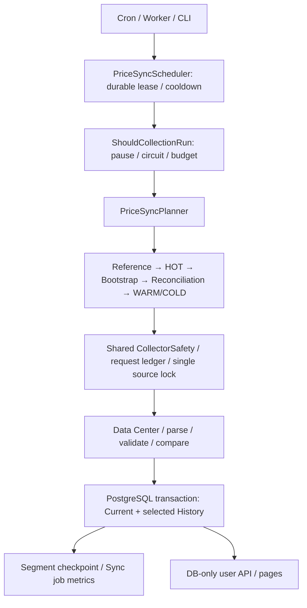

# PHASE 4.6C COMPLETION REPORT

기준: 2026-09-22 12:27 KST DB 감사. [실측 JSON](phase-4.6c-audit.json). 이후 시간에 따라 freshness/rolling budget은 달라진다.

## 1. Status

**PARTIAL — Phase 4.6C 소프트웨어와 검증 완료, 전체 Initial Bootstrap 진행 중.**

Bootstrap과 지속 갱신을 분리한 중앙 CLI job, durable scheduler 상태, 가격 변경/heartbeat 이력 정책을 구현했다. 실제 HOT Sync와 예산 제한 Bootstrap을 실행했다. 100% 구축을 한 세션에서 강행하지 않았다. Cron/worker는 연결 가능한 상태이며 자동 설치하지 않았다. Rank Reward는 UNRESOLVED, Pack Opening·가격 그래프는 미구현이다.

## 2. Initial Bootstrap

| 항목 | 이전 | 현재 |
|---|---:|---:|
| Full Run metadata 가격 Coverage | 2.24% | **3.06%** |
| Full Run 가격 선수 | 1,976 | 2,703 |
| Full Run 유효 강화 가격 | 25,688 | 35,139 |
| 완료 클래스 / 전체 | 14 / 153 | **17 / 153** |
| 남은 클래스 | 139 | 136 |
| 완료 leaf / split / pending | 36 / 23 / 140 | **47 / 31 / 137** |
| 생성된 전체 segment | 199 | 215 |
| 누적 가격 POST | 59 | 78 |
| 실패 / 중복 | 0 / 0 | 0 / 0 |

기존 run `cmualiypa0000tyfh10nnw2ax`를 재개했다. 새 배치는 robots 1 + POST 19 = HTTP **20회**, 이후 `REQUEST_BUDGET_EXHAUSTED`로 PAUSED. 가격 선수 727명·가격 9,451개를 추가했다. Pending 137개는 아직 발견되지 않은 하위 split을 제외한 숫자다. 추정 남은 POST는 1,135회다.

HOT를 포함한 전체 DB는 **2,977명 / 88,359명 = 3.37%**. Full Run의 3.06%와 혼동하지 않는다. Metadata는 판매/가격 존재 보장이 아니므로 최종 목표는 모든 planned segment 처리이며, metadata 가격 Coverage 100%를 보장하지 않는다.

## 3. Official Price Update Frequency Research

2026-09-22 10:44 KST에 robots 검사 후 공식 Data Center HTML을 예산 내에서 새로 확인했다. [공식 Data Center](https://fconline.nexon.com/datacenter)는 데이터의 2시간 단위 업데이트와 홈페이지 반영 지연을 안내한다. 또한 선수별 갱신 시점 차이 때문에 게임 내 기준가와 사이트 값이 일치하지 않을 수 있다고 설명한다.

- **Data Center:** 약 2시간 단위 업데이트 안내 확인. 반영 지연의 최대 길이는 확인되지 않았다.
- **실제 선수 기준가:** 선수별 시점 차이 안내는 있지만 정확한 산정 주기·거래 발생 조건·강화별 동시성은 미확인.
- **Collector:** 30분 간격 job 적격성 확인, HOT 6시간 / WARM 48시간 / COLD 336시간 자체 정책. 사이트의 갱신 주기와 별개다.
- 모든 가격의 동시 변경, 고정 정각, “최대 2시간 지연”, 거래된 선수만 변경된다는 주장은 하지 않는다.

작업 초반 점검 시간에는 가격 수집하지 않았다. [공식 점검 공지 6279](https://fconline.nexon.com/news/notice/view?n4ArticleSN=6279)가 09:30 조기 오픈으로 바뀐 것을 확인한 후 요청했다. 점검 대기 DB 기록 시도는 예정 종료 시각이 이미 지나 validation에서 거부되어, 실제 pause 행을 만들지는 않았다. 향후 `prices:control pause-until`로 점검 대기를 기록할 수 있다.

## 4. Source Change Detection

| Signal | 실제 관측 | 사용 |
|---|---|---|
| Global market version / snapshot ID | 신뢰할 신호 미확인 | 사용 안 함 |
| Authoritative market timestamp | 미확인 | 사용 안 함 |
| ETag | GET / POST 모두 없음 | Conditional request 구현 안 함 |
| Last-Modified | GET / POST 모두 없음 | Conditional request 구현 안 함 |
| Cache-Control | `private` | 시장 변경 신호로 해석하지 않음 |
| Age | 없음 | 사용 안 함 |
| Date | HTTP 응답 시각 | 시장 기준 시각으로 사용하지 않음 |

HTML hash는 증거 무결성용이며 market version이 아니다. 이미지 URL의 캐시 문자열도 가격 버전으로 사용하지 않는다. 따라서 매 tick마다 저렴한 version GET을 보내는 코드도 없다. `sourceVersionSupported=false`. Same-version / 304 테스트는 실제 지원 근거가 없어 N/A다.

## 5. Continuous Sync Architecture



`src/application/price-sync.ts`는 독립 job이다. 한 번 실행하면 적격한 작업 한 배치만 처리한다. 실행 타입은 BOOTSTRAP / HOT_SYNC / INCREMENTAL / FULL_RECONCILIATION / REFERENCE_SNAPSHOT. Bootstrap 완료 후 새 FULL을 계속 만들지 않는다. Reconciliation도 완료 후 설정된 기간이 지나야 새로 시작하며 진행 중이면 기존 run을 재개한다.

## 6. Current Price

`PlayerCurrentState`: variantId 기본 키, 정확한 Decimal(30,0) price, 최신 `observedAt`, 마지막 이력 시각 `historyAt`, source snapshot / history ID, 관측된 OVR/position. 기존 공식 이력으로 안전하게 backfill했다.

UI/API는 이 테이블의 최신 값·관측 시각을 사용한다. 기존 `PlayerPriceCurrent` materialized view는 이 상태의 정렬/랭킹 projection으로 유지하며 수집 후 refresh한다. UI의 Current는 projection refresh 지연에 의존하지 않는다. 공식 reference time은 계속 null이다. 한 batch의 검증·Current·History 변경은 하나의 transaction이다. 오래된 import는 Current를 되돌리지 않는다.

## 7. Price History

`PlayerPriceSnapshot.reason`에 INITIAL / PRICE_CHANGE / HEARTBEAT / REFERENCE_SNAPSHOT을 저장한다. 기존 30,106행은 의미를 추측해 재분류하지 않고 LEGACY로 보존했다.

INCREMENTAL / RECONCILIATION은 모든 변경을 저장하고 동일 값은 24시간 heartbeat가 지났을 때 저장한다. 관측이 없는 동안 heartbeat를 만들어내지 않는다. Reference mode는 관측마다 이력을 보존하지만 정확한 pack reference라는 인증을 부여하지 않는다. Bootstrap / 기존 명시적 수동 import는 기존 append 동작을 유지한다.

이번 HOT 3,562개 중 동일 992개는 **추가 History 0행**, 변경 2,570개만 이력 추가. Current의 last observed는 전체 재관측 가격에 갱신됐다. Raw 응답·source content·segment 증거는 보존하므로 모든 저장공간 증가가 제거되는 것은 아니다.

## 8. Price Change Detection

| 분류 | 처리 |
|---|---|
| NEW | Variant / Current / INITIAL History 생성 |
| CHANGED | Current 가격 갱신 + PRICE_CHANGE History 보존 |
| UNCHANGED | price 필드는 재기록하지 않고 observedAt/source 갱신; 필요 시 heartbeat |
| MISSING | 검증된 `-` 상태를 segment에 기록, Current·기존 History 삭제 안 함 |

누락 행을 parser 오류나 검색 결과 누락과 동일시하지 않는다. 조회에 없던 선수는 coverage의 not-listed/unchecked로 구분한다. 반복 누락으로 자동 UNAVAILABLE 전환은 아직 하지 않는다. 오래된 값은 staleness로 표시한다. **0강의 정상 no-price 표시를 유효 1~13강 Missing 지표에 포함하지 않는다.** 최초 HOT 출력에 포함됐던 0강 274건은 감사 단계에서 이 규칙에 따라 지표만 정정했다.

## 9. Full Refresh Cost

현재 metadata 88,359명·153개 클래스의 전체 계획으로 계산한다. 선수 한 명당 HTTP 한 번이 아니다. POST `/datacenter/PlayerList`는 클래스/OVR 범위 검색이며 한 선수의 여러 강화 가격을 함께 반환한다. 검색 cap은 200명, 검증된 다음 페이지가 없어 cap 도달 시 OVR을 분할한다.

| 계획 | 가격 POST 추정 | robots 포함 HTTP 추정 | 10초 간격 active 하한 | 120/day 단독 예산 하한 |
|---|---:|---:|---:|---:|
| Initial discovery 전체 | 1,213 | 1,277 | 3.55시간 | 10.64일 |
| 알려진 partition 재사용 Full Refresh | **1,183** | **1,246** | **3.46시간** | **10.38일** |

Initial 전체 평균은 metadata 가정상 약 72.84명 / 946.96 variants per POST. 실제 누적 Bootstrap은 **34.65명 / 450.5 variants per POST**다. 시작 전 initial 추정은 1,201 POST + 64 robots = 1,265회였고 새 split 관측 후 조정됐다.

**정확한 전체 요청 수는 아직 미확인이다.** 완료 클래스 17개만 실제 discovery 비용이 알려져 있다. 미확인 클래스는 `2×ceil(metadata count/150)−1` 트리 모델을 사용한다. 빈 구간·OVR 밀집·재시도·실제 거래 가능 선수 수에 따라 바뀐다. Metadata 기반 leaf 하한 533도 모든 metadata가 검색된다는 조건부 수치다. full plan을 먼저 계산했으나 정확한 실측 완료값으로 포장하지 않는다.

## 10. Full Refresh Every 2 Hours Scenario

- Full refresh HTTP 추정: **1,246회 / crawl**.
- 하루 12회: **14,952회 / day** (가격 POST 14,196회).
- 30일: **448,560회**.
- 자체 120/day 예산의 **124.6배**. 지연만 고려해도 한 번에 3.46시간이므로 2시간마다 완주할 수 없다. **사용하지 않는다.**

## 11. Incremental Strategy

- **HOT:** 판매 중인 검증된 공식 상품에서 도달 가능한 rank pack의 확인된 클래스 superset: UC 877, 26TOTS 866. 274명, 3,562 variants. 6시간 적격 기준. 실제 후보 확정/랭킹 인증을 의미하지 않는다.
- **WARM:** 실제 확보된 최대 가격이 높은 클래스 규칙. 현재 HOT를 제외하면 class 100 한 개, 48시간.
- **COLD:** 나머지 150개 클래스, 기본 336시간. 같은 query의 연속 두 결과에 new/changed가 없으면 non-HOT 간격을 2배로 늦출 수 있다.
- 동일 tier에서는 오래된 관측부터 처리한다. 아직 완주하지 않은 non-HOT 클래스는 bootstrap에 맡긴다. 사용자 조회 수·인기도·변동성 추정치를 만들어 넣지 않았다.

## 12. Incremental Cost

| 항목 | 가격 POST / sweep | 주기 | 가격 POST / day |
|---|---:|---|---:|
| HOT | 2 | 6시간 | 8 |
| WARM | 1 | 48시간 | 0.5 |
| COLD | 1,180 추정 | 14일 | 84.29 |
| 합계 | 해당 tick의 due subset | 혼합 | **92.79** |

HOT 한 sync는 **2 POST + 1 robots = HTTP 3회**. 반복 fresh/cooldown tick은 0회다. 일반 운영의 robots overhead는 HOT 4회/day와 나머지 19 POST/batch 분할을 가정해 약 9회/day: **101.79 HTTP/day, 3,053.57 / 30일**. Batch fragmentation·retry·priority interruption에 따른 추가 비용은 이 추정에 미포함이다.

120일 reconciliation을 상각하면 **112.17 HTTP/day**, reference 관측 1개 클래스 daily 사용 시 약 **114.17/day, 3,425.07 / 30일**. Reference 기본값은 OFF이며 실제 측정된 해당 pack class 한 요청 기준이다. 모든 pack 시간대가 같은 것으로 일반화하지 않는다.

## 13. Recommended Production Strategy

| 전략 | 추정 HTTP/day | Freshness / coverage | 복구·복잡도·공식 부하 | 사용 |
|---|---:|---|---|---|
| Full every 2h | 14,952 | 실행 자체가 예산과 불일치 | 낮은 논리 복잡도, 매우 큰 부하 | NO |
| Incremental | 101.79 | tier별 혼합; 신규 누락 영구 발견 보장 없음 | 낮은 요청량, resume 가능 | 정상 갱신 |
| Hybrid + 120-day reconciliation | 112.17 상각 | tier 혼합 + 주기적 전체 대조 | 상태 관리 추가, 발견/복구 가능 | **권장** |
| Target reference window | +2/day 조건부 | 대상·관측 시간대만 확보 | 정확한 기준값 인증은 별도 | 필요 시 |

Bootstrap 중에는 Reference → HOT → Bootstrap 우선. 30분마다 중앙 job을 호출하되 120 rolling-day 예산을 절대 넘기지 않는다. HOT 비용을 먼저 사용한 뒤 남는 예산으로 초기 구축을 진행한다. 남은 initial 요청의 조건부 하한은 약 1,195 HTTP이며, HOT 12/day를 제외한 108/day를 모두 쓸 수 있어도 약 11.1일이 필요하다. 실제로는 점검·쿨다운·분할·재시도 때문에 더 걸릴 수 있다.

완료 후에는 Incremental + 낮은 빈도의 Reconciliation. 120일은 현재 비용에 따른 **운영 설정값**, source truth가 아니다. 112.17/day는 여유가 작고 reconciliation 동안 COLD 갱신이 밀릴 수 있으므로 실측 비용·backlog로 주기를 재평가한다. 예산을 높여 맞추지 않는다. Reference는 현재 값 동기화와 별도 run/dataset이며 window 밖 capture를 과거 기준가로 바꾸지 않는다.

## 14. Request Safety

- 공유 ledger: 분 6 / rolling hour 60 / rolling 24h 120 / execution 20회. robots·연구 GET·재시도 포함.
- source concurrency **1**, durable DB source lease + scheduler lease. 재실행해도 budget이 초기화되지 않는다.
- 요청 간격 10초, batch 후 scheduler cooldown 30분. HTTP 403/429/보안 페이지는 즉시 circuit, 반복 server/timeout/이상 응답은 threshold 3, circuit cooldown 24시간.
- `PRICE_COLLECTION_ENABLED=false`, DB `prices:control disable`, `pause-until <ISO> <reason>` 제공. enable은 circuit 또는 maintenance pause를 지우지 않는다.
- **No explicit safe request rate confirmed.** robots에 해당 경로 금지가 없다는 것은 허가/재배포 라이선스가 아니다. [기존 공식 정책 조사](phase-4.6b-operations.md)를 유지한다. 차단 한계 시험·접근 제한 우회 없음.
- 감사 시 rolling hour 20 / rolling day 50, circuit CLOSED, active collector 없음. 이 Phase 직접 HTTP는 **25회**(연구 2 + HOT 3 + Bootstrap 20). 웹 브라우징 조회는 이 collector ledger와 별도다.

## 15. Scheduler

```sh
npm run prices:sync -- --dry-run
npm run prices:sync -- --max-segments 20
npm run prices:bootstrap -- --max-segments 20
npm run prices:reconcile -- --max-segments 20
npm run prices:sync:status
npm run prices:cost -- --output .local/price-cost.json
npm run prices:control -- disable
```

`prices:bootstrap` / `prices:reconcile`는 **동일 중앙 조정기의 진입 명칭**이다. 해당 타입 강제 실행이나 쿨다운 우회가 아니다. 실제 선택 타입은 출력의 `type`을 확인한다. 기존 low-level collect CLI는 명시적 수동 운영용으로 유지하되 동일 source 예산/lock/circuit/maintenance pause를 사용한다. 정상 자동 운영은 새 중앙 job 하나만 호출한다.

설정: `PRICE_SYNC_INTERVAL_MINUTES=30`, `PRICE_FULL_RECONCILIATION_DAYS=120`, `PRICE_HISTORY_HEARTBEAT_HOURS=24`, `PRICE_SYNC_VERY_STALE_HOURS=720`, reference enable/pack + 기존 HOT/WARM/COLD/안전 정책. `.env.example`에 설명을 추가했고 실제 secret은 변경하지 않았다.

Cron/worker는 저장소를 cwd로 하고 Node/npm 경로와 DB 환경을 제공하여 `npm run prices:sync`를 30분 간격 호출한다. 같은 시각 여러 process가 시작돼도 scheduler lease가 두 번째를 거부한다. 독립적인 bootstrap/reconcile cron을 추가하지 않는다. Web page traffic은 scheduler를 실행하지 않는다. Process가 죽으면 lease 만료 후 다음 tick이 interrupted job을 표시하고 DB checkpoint에서 이어간다.

## 16. Sync Run Metrics

| 실행 | HTTP / POST | 선수 | 유효 variants checked | NEW | CHANGED | UNCHANGED | MISSING 1~13 |
|---|---:|---:|---:|---:|---:|---:|---:|
| HOT 11:00 KST | 3 / 2 | 274 | 3,562 | 0 | **2,570** | **992** | 0 |
| 즉시 재실행 | **0 / 0** | 0 | 0 | 0 | 0 | 0 | 0 |
| Bootstrap 12:11~12:14 KST | 20 / 19 | 727 | 9,451 | **9,451** | 0 | 0 | 0 |

HOT 효율: 137 players / POST, 1,781 variants / POST, 1,285 changed / POST. Bootstrap 이번 batch: 38.26 players / POST, 497.42 variants / POST. 실패 0. `PriceSyncJob`은 type/run/status/timestamps/nextEligible/metrics, 기존 CollectionRun은 segment·request·response evidence·resume를 담당한다.

## 17. Database Growth

현재 **Current 38,701행**, **History 42,127행**. 이력 구성: LEGACY 30,106 / INITIAL 9,451 / PRICE_CHANGE 2,570. 실제 동일 HOT 992건을 생략했다. Rank snapshot 0.

미래 변경률을 한 번의 실측으로 예측하지 않는다. 아래는 steady state에서 모든 tier refresh가 예정대로 수행되고 reconciliation을 120일로 상각한 **추가 History 행 수 시나리오**다. 초기 추가 발견·reference·재시도·raw evidence 용량은 별도다.

| 대상 크기 가정 | 30일 추가 | 1년(365일) 추가 |
|---|---:|---:|
| 현재 확보 조합 수 유지 | 약 **212,893 ~ 533,473** | **2,590,199 ~ 6,490,589** |
| 모든 metadata ×13이 유효하다는 상한 시나리오 | **2,868,883 ~ 3,189,463** | **34,904,745 ~ 38,805,135** |

산식: HOT H=3,562, WARM W=1,638, COLD C; daily `H×[1,4] + W/2 + C/14 + (H+W+C)/120`. 하단은 값이 같아 HOT 하루 heartbeat만 남는 경우, 상단은 HOT 매 관측 변경되는 경우다. COLD는 14일마다 관측하므로 동일 값도 heartbeat가 된다. 실제 상한 metadata 조합 수 **1,148,667**은 가격이 존재한다는 보장이 아니다. Raw HTML/JSON·index bytes와 bootstrap 성장 때문에 디스크 용량은 별도 모니터링해야 한다. 기존 이력을 삭제하는 aggressive compression은 하지 않았다.

## 18. Tests

- **Unit: 114 PASS** — 우선순위, history decision, 설정, 기존 정책/파서/상품 로직.
- **Integration: 64 PASS** — 500B→520B Current/History, NEW, 동일 값의 observedAt 갱신 및 이력 억제, heartbeat/reference, invalid batch rollback, out-of-order import, 누락 가격 유지, 이력 0행인 run의 Coverage, DB client restart 후 cooldown/Current 유지, 완료 클래스가 due 계획에서 빠져도 기존 증분 run의 pending 클래스 Resume.
- **Sync budget / Resume:** 가짜 HTTP로 Incremental execution 예산 1회에서 robots만 실행 후 PAUSED; 새 execution에서 같은 pending segment 재개. 공유 rolling ledger 유지.
- **Safety:** 100회 허용/101번째 차단, 두 번째 collector 거부, persistent budget, 403/429/security/5xx circuit, kill switch 회귀 PASS.
- **Priority:** Reference → HOT → Bootstrap → reconciliation → 일반 incremental 확인. 실제 첫 sync는 HOT, 다음 적격 sync는 기존 Bootstrap을 선택했다.
- **E2E: 69 PASS** — desktop/mobile/tablet의 FC 충전→구매→인벤토리→reward tree/probability→players/enhancement/current price, 브라우저 Data Center 요청 없음.
- 사용자 서비스에서도 fetch spy로 가격 재관측 시각 조회가 외부 HTTP 없이 동작함을 확인했다. User cache miss는 가격 없음으로 표시한다.
- Source not updated / 304: **N/A**, 신뢰할 signal 부재. 가짜 signal 테스트 없음.

## 19. Build Verification

- `npm run build`: **PASS**, 최종 기본 Turbopack production build.
- `npm run typecheck`: **PASS**.
- `npm run lint`: **PASS**.
- Webpack production build도 PASS. 최초 restricted 실행의 실패가 Turbopack cache에 남아 동일 포트 바인딩 오류가 재발했다. 실패 cache를 `.local`에 보존한 뒤 새 cache로 기본 build가 통과했다. 기본 package build 명령을 변경하지 않았다.
- 추가 migration `202609220001_price_sync`를 개발 DB와 전용 테스트 DB에 적용했다. 기존 history를 보존했고 current state를 backfill했다.

## 20. Known Risks

1. 공식 안전 요청률·자동 수집 라이선스는 확인되지 않았다. 보수적 예산도 무차단을 보장하지 않는다.
2. Source 2시간 안내는 정확한 게임 내 가격 시각이나 고정 refresh 경계를 제공하지 않는다. No version / conditional cache support confirmed.
3. Full 비용은 아직 모델이다. 같은 OVR에 cap 이상 선수가 모이면 기존 segmentation으로 완주하지 못할 수 있다. 임의 pagination/조건 조작으로 우회하지 않는다.
4. Missing은 자동 삭제하지 않으므로 last-known 값이 오래 남을 수 있다. 표시되는 관측 시각과 staleness를 함께 해석해야 한다.
5. 현재 metadata는 기존 88,359명/153클래스 dataset이다. 신규 metadata 반영·신규 클래스 발견은 별도 metadata job/재계획이 필요하다.
6. Scheduler는 단일 프로세스 환경용 CLI-ready job이다. 자동 cron 설치, 분산 preemption, 고급 user-interest/volatility 점수는 없다. 동작 중인 batch를 다른 scheduler가 강제로 빼앗지 않는다.
7. Freshness와 reference validity는 다르다. `observedAt`이 최근이어도 pack 00~01시 기준가가 인증되는 것은 아니다.
8. 120일 reconciliation 비용은 상각치다. 실제 진행 기간에는 cold backlog가 늘 수 있다. budget 때문에 freshness SLA는 best effort다.

## 21. Recommended Next Step

**안전한 Bootstrap을 계속하면서 Reference Snapshot Phase를 병행 준비한다.** 수집은 새 중앙 job 하나로 조율한다. HOT 갱신이 Bootstrap 뒤로 영원히 밀리지 않게 유지한다. 다음 Phase에서는 대상 pack 조건/eligibility, 정확한 reference timestamp의 증거, snapshot completeness/coherence를 우선 검증한다. 전체 구축을 기다린다는 이유로 현재 값과 기준 시각 값을 섞지 않는다.

## 22. Ready for Pack Opening?

**NO.** Current Price synchronization은 동작하지만 정확한 pack reference dataset과 후보 eligibility가 확보되지 않았다. Rank Reward는 **UNRESOLVED**, verified rank snapshot은 **0**이다. TOP N을 실제 선수로 임의 확정하지 않았다. Pack Opening과 가격 차트 UI는 구현하지 않았다.
